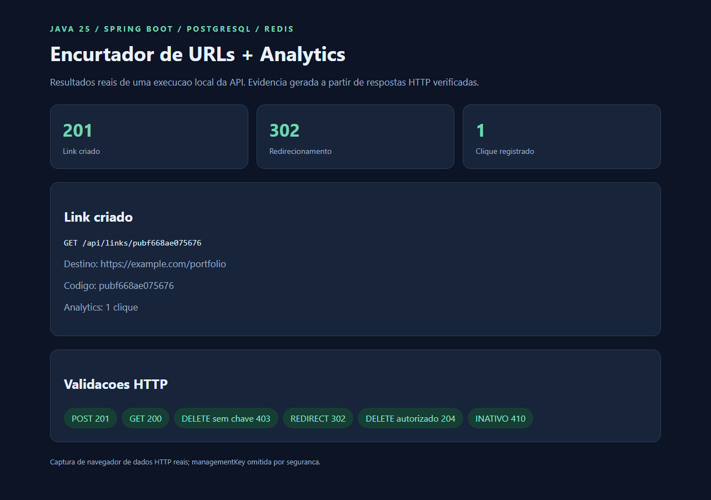

# Encurtador de URLs com Analytics

API REST em **Java 25**, **Spring Boot 3.5**, PostgreSQL 17, Flyway e Redis 7 para criar links curtos, redirecionar e contabilizar acessos.



## Funcionalidades

- `POST /api/links`: cria um link, opcionalmente com `alias` e `expiresAt`, retornando uma `managementKey` privada **uma unica vez**.
- `GET /api/links/{code}`: consulta metadados publicos (sem revelar a chave).
- `GET /{code}`: redireciona (302) e registra o clique.
- `GET /api/links/{code}/analytics`: retorna `totalClicks`.
- `DELETE /api/links/{code}`: desativa usando o cabecalho `X-Management-Key` (204).

Status relevantes: `400` entrada invalida; `403` chave ausente/invalida; `404` link inexistente; `409` alias duplicado; `410` link desativado/expirado.

## Execução local

Requisitos: JDK 25, Maven, Docker Desktop com Docker Compose.

```bash
docker compose up -d
mvn clean verify
mvn spring-boot:run
```

A API usa porta `8081` por padrao conforme `application.properties`. Configure banco/Redis via variaveis `DB_URL`, `DB_USER`, `DB_PASSWORD`, `REDIS_HOST`, `REDIS_PORT` conforme necessario.

### Exemplo de criacao

```bash
curl -X POST http://localhost:8081/api/links \
  -H 'Content-Type: application/json' \
  -d '{"url":"https://example.com","alias":"meulink"}'
```

A chave `managementKey` deve ser guardada pelo criador; o servidor armazena apenas seu hash SHA-256. Para desativar:

```bash
curl -X DELETE http://localhost:8081/api/links/meulink \
  -H 'X-Management-Key: SUA_CHAVE_PRIVADA'
```

## Consistência e testes

- PostgreSQL e Flyway V1/V2 para persistencia e migracoes.
- Bloqueio pessimista no banco para serializar redirecionamentos e desativacoes do mesmo link.
- Registro transacional de acessos e invalidacao do cache Redis apos commit.
- Redis com TTL maximo de 60 segundos; a verificacao de estado do link continua no PostgreSQL.
- `mvn clean verify`: testes unitarios de geracao de codigos, autorizacao e callbacks de commit/rollback.
- Validacao HTTP local executada: 201/200/403/302/204/410 e 20 redirects simultaneos com 21 cliques persistidos.

**Limites conhecidos:** o teste de concorrencia nao prova a corrida DELETE versus GET nem elimina todas as possibilidades de reordenacao de callbacks Redis. O cache nao evita a consulta PostgreSQL em cada redirecionamento.

## Evidência

`docs/images/funcionamento.png` e uma captura do navegador de um relatorio HTML alimentado por respostas HTTP reais da API durante a validacao de publicacao. Nenhuma chave privada aparece na imagem.

## CI

GitHub Actions executa `mvn -B clean verify` com Temurin 25 e um smoke test HTTP contra PostgreSQL/Redis.